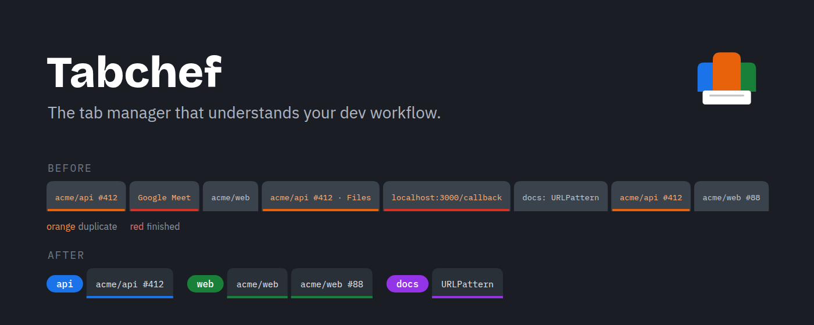
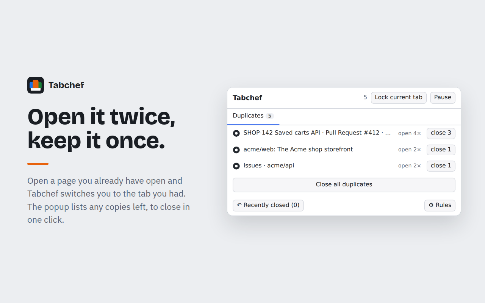
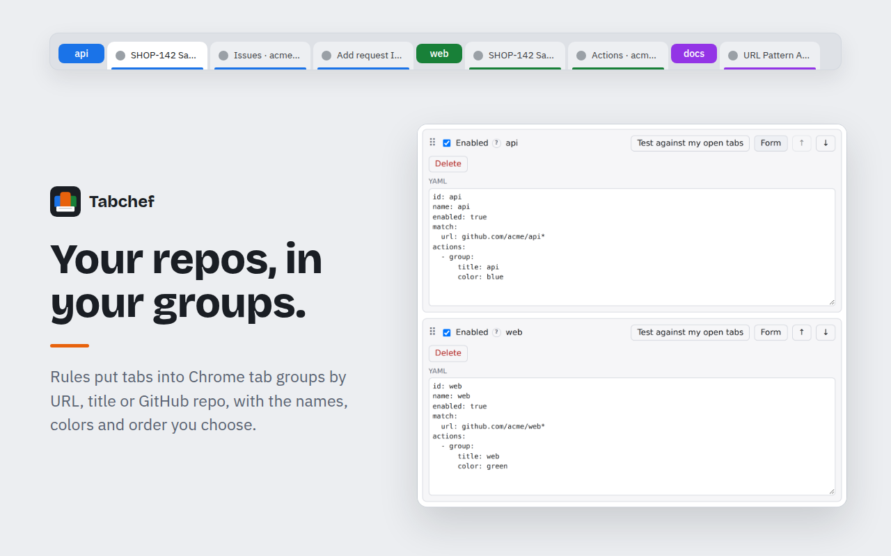
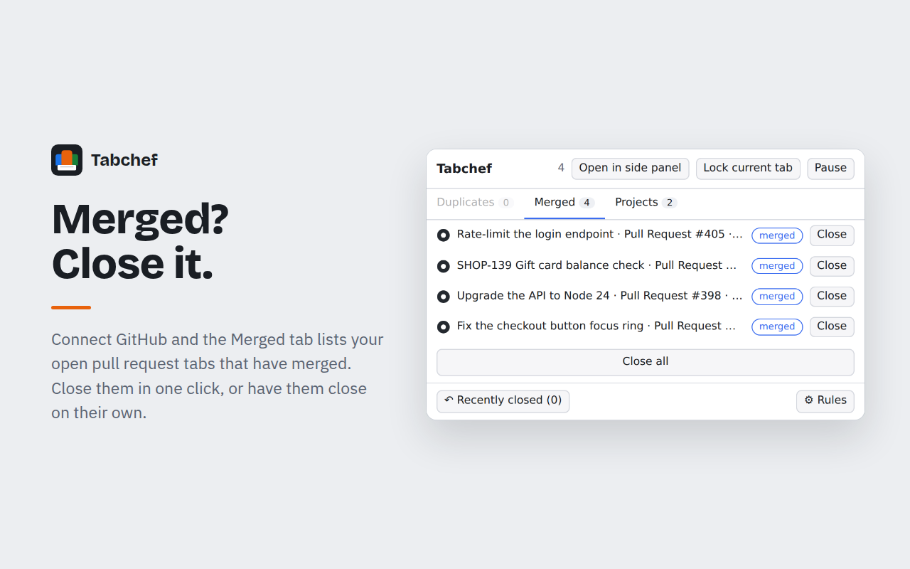
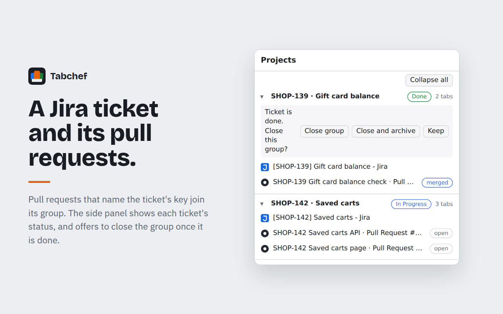
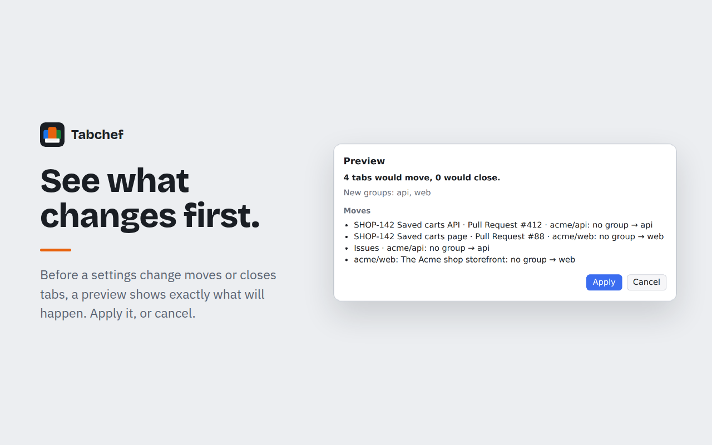

I ran two tab extensions that kept fighting: one grouped GitHub tabs by repo, the other closed duplicates. Neither knew that a pull request's Files tab and its Conversation tab are the same page to me. So I wrote one extension that does both, from one set of rules.

It's called [Tabchef](https://github.com/ecoutu/tabchef): recipes for your tabs.



## What it does

- **Groups** tabs into Chrome tab groups by URL, title or GitHub repo, with the names, colors and order you choose. Group order in the tab bar matches the order in your settings.
- **De-duplicates.** Opening a page you already have open switches you to the existing tab. A pull request's Files, Commits and Checks pages count as the pull request itself. De-duplication always closes the new tab, never the one you were using.
- **Closes finished tabs:** OAuth callback pages, redirect pages you list, and Google Meet tabs after the call ends. Pinned and locked tabs are never closed, and a tab with unsaved form input is never closed without asking.



## Rules you can read

Rules match on URL patterns, page titles and, on sites you allow, page text. They act by grouping, de-duplicating or closing. Rules ship in **recipes**, which are plain YAML data with no code in them, so you can read exactly what a recipe will do before you turn it on. This rule comes from the built-in GitHub pull requests recipe, narrowed to one organization's repositories:

```yaml
recipe: github-prs
name: GitHub pull requests
rules:
  - id: group-by-repo
    name: Group GitHub tabs by repository
    match:
      url: "github.com/acme/:repo*"
    actions:
      - group:
          title: "{repo}"
          color: grey
```

Recipe rules are read-only; **Customize** copies one into your own rules, which you edit in a form or as YAML. Rules run in priority order, and you can file them into named sections that collapse and move as one block.



## It knows about the work around a tab

Connect GitHub and the **Merged** tab lists pull requests that have merged, so you can close them.



Connect Jira and turn on a Jira ticket recipe, and each ticket becomes a **project**: the ticket's tab is grouped with the pull requests that name its key in their title or branch. The popup's Projects tab and the side panel show each ticket with its status and its pull requests. When the ticket is done, Tabchef offers to close the group, or close it and archive the project so you can reopen it later. For work without a ticket, the Manual projects recipe lets you name a project and add tabs to it by hand.



## No surprises

Every settings change goes through a preview before any tab moves or closes. A History shows what happened and which rule did it, and "Why is this tab here?" names the rule behind any open tab.



Tabchef has no servers and no analytics. Rules and tab data stay in your browser, and settings sync through your Chrome account. With GitHub or Jira connected, it asks those services directly from your browser, and tokens stay in it.

## Try it

Tabchef is coming to the Chrome Web Store. Until then, download `tabchef-<version>-chrome.zip` from the [latest release](https://github.com/ecoutu/tabchef/releases/latest), unzip it, and load the folder with **Load unpacked** on `chrome://extensions` (with Developer mode on).

I'd like feedback on the rule language (see the [guide to recipes and rules](https://github.com/ecoutu/tabchef/blob/main/docs/recipes.md)) and on which recipes you'd want built in. There's an [issue form for recipe ideas](https://github.com/ecoutu/tabchef/issues/new?template=recipe_idea.yml), and the comments below are open too.
